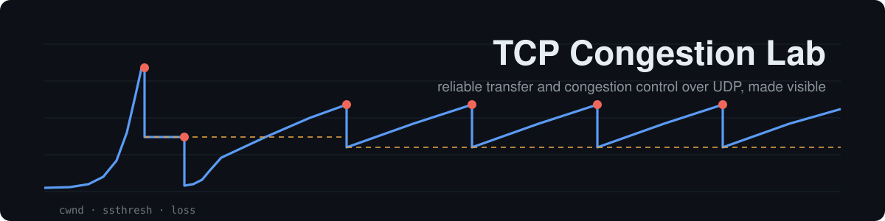
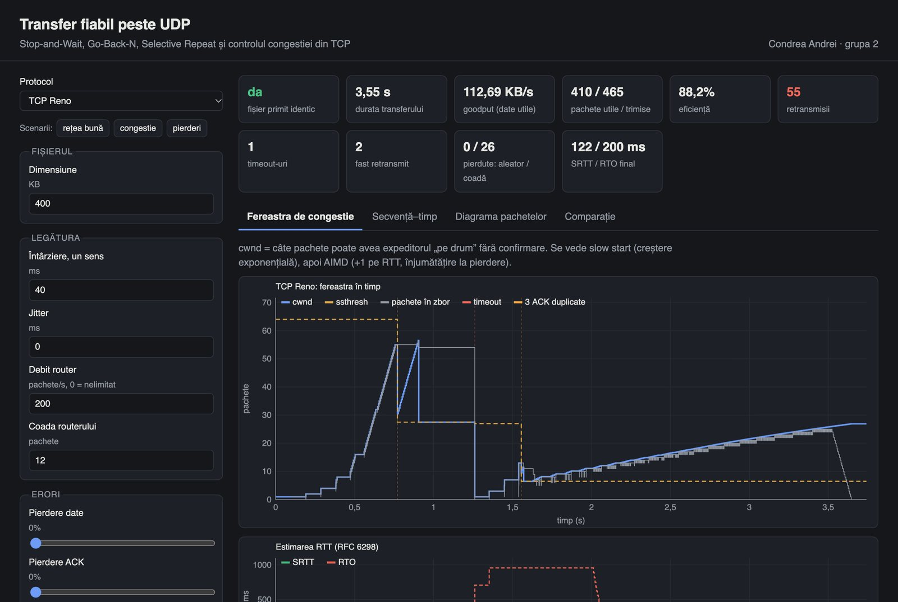
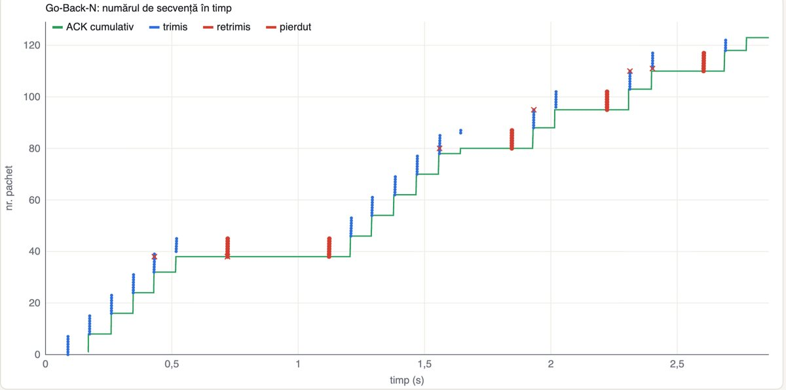
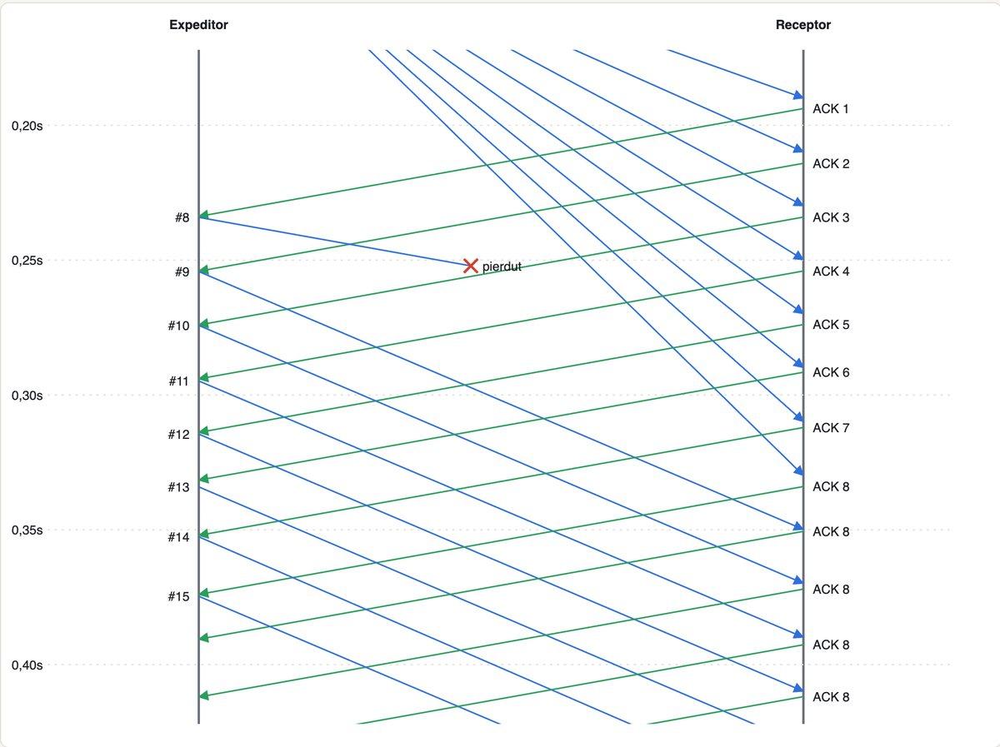
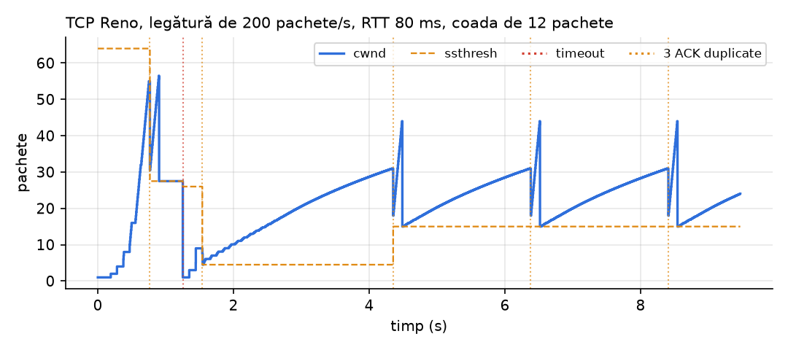
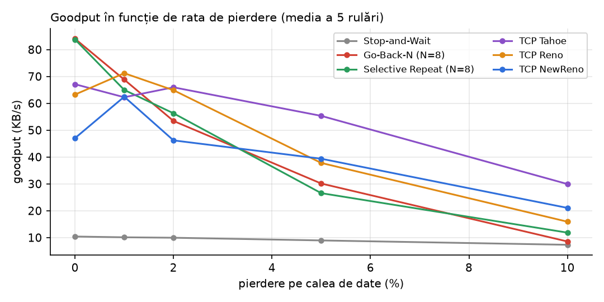
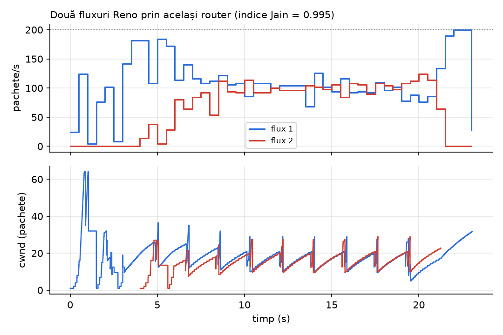

<div align="center">

<picture>
  <source media="(prefers-color-scheme: dark)" srcset="docs/assets/header-dark.svg" />
  <source media="(prefers-color-scheme: light)" srcset="docs/assets/header-light.svg" />
  
</picture>

<p><strong>Stop-and-Wait, Go-Back-N, Selective Repeat and three flavours of TCP congestion control,<br />
implemented over UDP and drawn packet by packet.</strong></p>

<p>
  <a href="#quick-start">Quick start</a>
  &nbsp;·&nbsp;
  <a href="#what-you-can-see">What you can see</a>
  &nbsp;·&nbsp;
  <a href="#results">Results</a>
  &nbsp;·&nbsp;
  <a href="referat/Referat_TCP_Condrea_Andrei.pdf">Report (RO, PDF)</a>
  &nbsp;·&nbsp;
  <a href="README.ro.md">Citește în română</a>
</p>

<p>
  <a href="https://github.com/AndrewTechTips/tcp-congestion-lab/actions/workflows/tests.yml"></a>
  
  
  
  <a href="LICENSE"></a>
</p>

</div>

<p align="center">
  
</p>

On localhost UDP never loses anything, so you never get to see why TCP works the way it does.
This project puts a deliberately bad network between a sender and a receiver: propagation delay,
random loss, flipped bits, and a router that forwards 200 packets a second and drops whatever does
not fit in its queue. Then it runs six reliable-transfer protocols across it and records every
packet, ACK, timeout and window change.

It was my project for the Computer Networks course (3rd year, Computer Science). The written
report, in Romanian, is in [`referat/`](referat/).

## Highlights

- **Six protocols, one event loop.** Stop-and-Wait, Go-Back-N, Selective Repeat, TCP Tahoe, Reno
  and NewReno share the same sender loop. They differ only in the window size and in what they do
  on an ACK, a duplicate ACK or a timeout.
- **Congestion you can cause.** The simulated router has a finite queue and tail drop, so TCP's
  losses come from its own sending rate, not just from a dice roll.
- **TCP's real mechanisms.** RTO from RFC 6298 with Karn's rule and exponential backoff,
  fast retransmit on three duplicate ACKs, fast recovery, and NewReno's partial-ACK handling
  from RFC 6582.
- **Every transfer is checked.** The receiver's bytes are compared with the sender's by SHA-256.
  Across all the experiments below, the file arrived identical every time.
- **No dependencies.** The protocol, the experiments and the web server use only the Python
  standard library. The charts in the browser are hand-drawn on canvas.

## What you can see

<table>
  <tr>
    <td width="50%"></td>
    <td width="50%"></td>
  </tr>
  <tr>
    <td><sub><b>Sequence–time plot.</b> Each dot is a packet. With Go-Back-N every loss turns into a red column: after the timeout the whole window of 8 is sent again.</sub></td>
    <td><sub><b>Packet diagram.</b> The ladder from the lecture slides, drawn from a real run. Packet #8 is lost, so the receiver discards #9 to #15 and repeats “ACK 8”.</sub></td>
  </tr>
</table>

The interface has four views: the congestion window with ssthresh and loss events, the
sequence–time plot, the packet diagram, and a comparison that runs every protocol at 0–10% loss.

## Quick start

You need Python 3.8 or newer. Nothing to install.

```bash
git clone https://github.com/AndrewTechTips/tcp-congestion-lab.git
cd tcp-congestion-lab
python3 server.py            # opens http://localhost:8000
```

Pick a protocol, press **congestie** (congestion) or **pierderi** (losses), then
**Pornește transferul** (start the transfer).

From the terminal:

```bash
python3 run.py --mode reno --size 500 --loss 0.02   # one transfer, with statistics
python3 compare.py --runs 5                         # every protocol at 0–10% loss -> rezultate/
python3 fairness.py                                 # two flows through one router
python3 -m unittest -v                              # the test suite
```

## Results

All numbers come from this repository and can be reproduced with the commands above
(`python3 figuri.py` redraws every chart).

<p align="center">
  
</p>

**TCP Reno finds the link on its own.** Slow start doubles the window every RTT and overshoots to
about 55 packets, while only 28 fit in the network (16 in flight plus 12 queued). Dozens of
packets are dropped at once, Reno falls into a timeout, and from then on it settles into the AIMD
sawtooth between 15 and 31 packets. Even after each halving, the window still covers the
bandwidth-delay product, so the link stays busy.

<p align="center">
  
</p>

| Goodput (KB/s), mean of 5 runs | 0% | 1% | 2% | 5% | 10% |
|---|---:|---:|---:|---:|---:|
| Stop-and-Wait | 10.4 | 10.1 | 10.0 | 9.0 | 7.3 |
| Go-Back-N (N = 8) | 84.0 | 68.8 | 53.4 | 30.1 | 8.6 |
| Selective Repeat (N = 8) | 83.8 | 65.0 | 56.3 | 26.6 | 11.9 |
| TCP Tahoe | 67.1 | 62.3 | 66.0 | 55.3 | 30.0 |
| TCP Reno | 63.3 | 71.2 | 64.9 | 37.8 | 15.9 |
| TCP NewReno | 47.0 | 62.5 | 46.2 | 39.4 | 21.1 |

Two results surprised me. Without loss, the fixed windows of Go-Back-N and Selective Repeat beat
TCP: a window of 8 never fills the router's queue, while TCP has to probe for the limit and pays
for it in slow start. And NewReno was the slowest TCP on a clean link, because after slow start it
repairs one loss per RTT, and there were more than 20 of them. That is the gap SACK closes. With
real loss the picture flips: Go-Back-N collapses and the TCP variants hold up best.

<p align="center">
  
</p>

**AIMD is fair in practice.** Two Reno flows share one router. The second joins after four
seconds, and within a few cycles they split the link at about 107 and 92 packets a second.
Jain's fairness index comes out at 0.995, where 1 means a perfectly even split.

## How it works

```
 web/ (HTML + JS) ──► server.py ──► session.py ◄── run.py, compare.py, fairness.py
                                       │
                 ┌─────────────────────┴─────────────────────┐
                 ▼                                           ▼
          sender.py ── DATA ──► Link + Router ── UDP ──► receiver.py
          (window, cwnd,         (delay, loss,           (buffer, ACKs)
           timers, RTO)           queue, corruption)
                 ▲                                           │
                 └──── UDP ◄──── Link (ACK path) ◄──── ACK ──┘
```

| File | Role |
|---|---|
| `rdt/packet.py` | 13-byte header (type, seq, ack, length, checksum) and the RFC 1071 checksum |
| `rdt/link.py` | the simulated link, and the `Router` queue that several flows can share |
| `rdt/rtt.py` | SRTT, RTTVAR and RTO as in RFC 6298 |
| `rdt/sender.py` | the event loop and all six modes |
| `rdt/receiver.py` | in-order, buffering and selective receivers |
| `rdt/session.py` | runs a full transfer and collects the event log the charts are drawn from |

Packets are numbered, not bytes as in real TCP. It keeps the charts readable and changes nothing
about the mechanisms. The other simplifications (fixed receiver window, no SACK, an initial
sequence number of 0) are listed in the report.

## Tests

```bash
python3 -m unittest -v
```

16 tests, run on every push. They check the checksum against the worked example in RFC 1071,
that flipping any single bit of a packet is caught, the RFC 6298 formulas and backoff, the router
dropping exactly what does not fit, and that all six protocols deliver an identical file, both on
a clean link and with 5% data loss, 3% ACK loss and 2% corrupted packets.

## Wireshark

`wireshark/rdt.lua` is a dissector for the protocol: copy it into Wireshark's personal plugins
folder and captures show `DATA seq=12 len=1000` or `ACK 13` instead of raw UDP bytes.
`wireshark/captura.sh` runs a lossy Reno transfer between two processes and records it with
`tcpdump` on the loopback interface (it asks for your password, since capturing needs root).

## Licence

[MIT](LICENSE)
